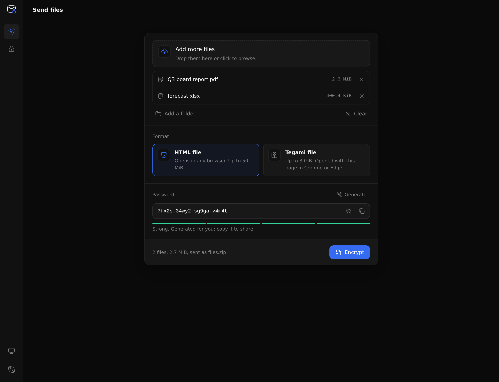
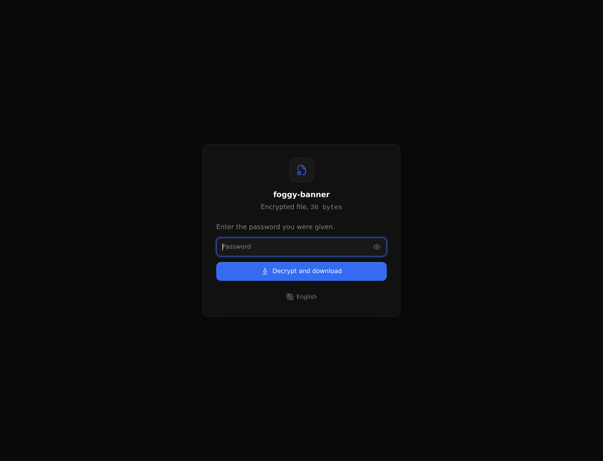
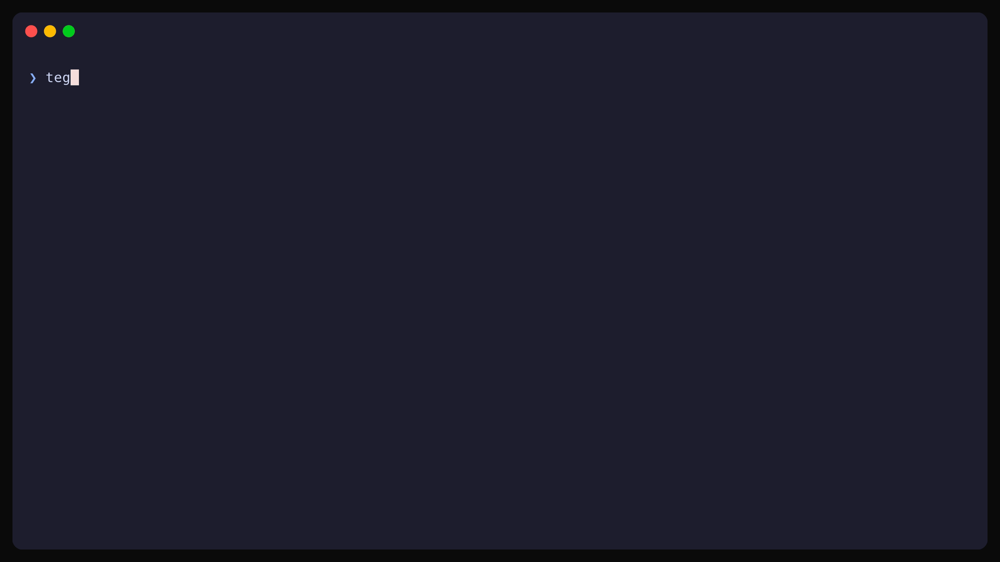

# Tegami

[English](README.md) | **日本語**

ファイルをパスワードで暗号化して送れます。受信者はアカウントもインストールも不要で、オフラインのブラウザーで開けます。

処理はすべて手元のデバイスで行います。Tegami のページはネットワークに接続できず、復号したファイルはダウンロードされるだけで、開いたり実行したりされることはありません。



## はじめに

1. [最新のリリース][releases]から `tegami.html` をダウンロードします（先に[改ざんがないか確認](docs/getting-started.md#verifying-downloads)してください）。
2. ブラウザーで開きます。「送る」でファイルまたはフォルダーをドロップし、形式を選びます。強力なパスワードが自動で入力されるので、コピーするか自分で入力します。「暗号化」を選択します。
3. できたファイルを受信者に送ります。ファイル名は `quiet-harbor` のようなコードネームになり、元のファイル名は隠されます。パスワードは電話など**別の方法**で伝え、コードネームも添えてください。

受信者はファイルを開いてパスワードを入力するだけです。



ページはブラウザーの言語設定に合わせて日本語または英語で表示され、言語メニューで切り替えることもできます。

## 形式の選び方

| 形式 | 向いている用途 | サイズ上限 | 受信者に必要なもの |
| --- | --- | --- | --- |
| **HTML ファイル** | ほとんどの受け渡し。1 つのファイルとして添付できる | 50 MiB | 最近のブラウザー |
| **Tegami ファイル**（`.tegami`） | 大きなファイル | 3 GiB | 信頼できる `tegami.html` と Chromium 系ブラウザー（Chrome、Edge、Brave） |

## コマンドライン

`tegami` コマンドを使うと、同じ受け渡しファイルをターミナルやスクリプトで作成・解除でき、`tegami.html` 自体も生成できます。

<picture>
  <source media="(prefers-reduced-motion: reduce)" srcset="docs/assets/terminal.png">
  
</picture>

```sh
# パスワードを生成します。受信者には別の方法で伝えてください。
tegami password > password.txt

# ファイルを暗号化します。コードネームが表示されます。
tegami pack --input report.pdf --output delivery.html < password.txt

# もう一度開きます。
tegami open --input delivery.html < password.txt

# パイプも使えます。
pg_dump shop | tegami pack --input - --name shop.sql --output - \
  --format blob --password-file password.txt > shop.tegami
```

すべてのオプションは [CLI リファレンス](docs/cli-reference.md)（英語）を参照してください。

## インストール

- Linux、macOS、Windows 用のビルド済みバイナリと `tegami.html` は[リリースページ][releases]にあります。
- **Go**: `go install github.com/rubyattack3r/tegami/cmd/tegami@latest`
- **Nix**: `nix run github:rubyattack3r/tegami -- studio`

詳しい手順と確認方法は [docs/getting-started.md](docs/getting-started.md)（英語）を参照してください。

## ドキュメント

現在、詳しいドキュメントは英語のみです。

| ガイド | 内容 |
| --- | --- |
| [Documentation index](docs/index.md) | すべてのドキュメントの入口 |
| [Getting started](docs/getting-started.md) | ダウンロード、リリースの確認、最初の受け渡し |
| [Studio guide](docs/studio.md) | ブラウザーでのファイルの送信と解除、トラブルシューティング |
| [CLI reference](docs/cli-reference.md) | `tegami pack`、`tegami open`、パイプ、JSON 出力、終了ステータス |
| [Security model](docs/security.md) | Tegami が守るもの、守らないもの、受信者に見える情報 |
| [File formats](docs/formats.md) | `tegami/v1` の形式仕様 |
| [Developer documentation](docs/development/index.md) | 開発環境、アーキテクチャ、リリース手順（開発者向け） |

脆弱性の報告方法は[セキュリティポリシー](SECURITY.md)を参照してください。

[releases]: https://github.com/rubyattack3r/tegami/releases/latest
