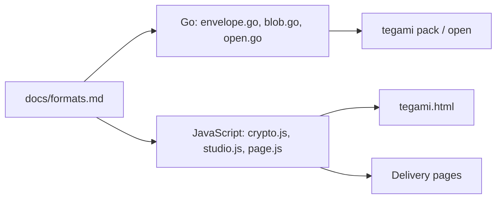

# Architecture

Tegami is one Go module with pinned Go crypto dependencies. The same formats are
implemented twice: in Go, for the CLI, and in JavaScript, for the pages that
run in the browser. Most rules in [`AGENTS.md`](../../AGENTS.md) exist to keep
those two in step.

## Layout

| Path | Role |
| --- | --- |
| `cmd/tegami` | CLI entrypoint: argument parsing, pipes, JSON output, exit statuses |
| `internal/envelope` | Formats, encryption, page assembly, and their tests |
| `internal/envelope/assets` | The browser pages: HTML, CSS, vanilla JavaScript, translations, codename lists |
| `scripts/icons` | Converts Hugeicons into the inline icon sprite |
| `scripts/browsercheck` | Dependency-free browser/CLI integration harness |
| `wasm` | Vendored Monocypher and the reproducible Argon2id WASM wrapper |

`internal/envelope` is split by concern:

| File | Responsibility |
| --- | --- |
| `envelope.go` | HTML deliveries: sealing and the delivery page |
| `blob.go` | Streaming `.tegami` deliveries, written in 4 MiB records |
| `open.go` | Reading and unlocking deliveries for `tegami open` |
| `kdf.go` | Fixed Argon2id profile, key commitment, and filename padding |
| `codename.go` | Codenames from envelope IDs |
| `assets.go`, `csp.go` | Embedding the pages and allowing their inline code by hash |
| `i18n.go` | Translation catalogs for the pages |

## Two implementations of one format

`tegami/v1` is specified in [File formats](../formats.md). A change to a
format, its authenticated data, a limit, or the filename rule lands in Go, in
JavaScript, and in that specification together, with a round-trip test. The
Studio and the CLI read `tegami/v1` only.

## The pages

Each page is an HTML asset with markers for its CSP, its one inline style, and
its one executable inline script. `assemblePage` inserts them and allows them
by SHA-256 hash, after any template rendering, so every build of
`tegami.html` is byte-identical and can be verified by rebuilding it.
The shared `crypto.js` is prepended to each page's script. The Argon2id WASM
module is embedded as Base64 data, instantiated locally, and permitted by
`wasm-unsafe-eval`; JavaScript string evaluation remains blocked.

- **The Studio** (`studio.html`, `studio.js`) creates and opens deliveries.
  An HTML delivery it creates is a copy of its own markup, captured before the
  script changes anything, with the encrypted package embedded and
  `body[data-mode=envelope]` set to show only the unlock card.
- **The CLI delivery page** (`page.html`, `page.js`) is rendered by
  `html/template` for `tegami pack --format html`.
  It carries only the translations it uses and never names Tegami.

Data a page reads, such as the package, the translations, and the codename
lists, sits in `<script type="application/json">` elements, which are never
executed and so are outside the CSP.

## Argon2id in the browser

Go uses `golang.org/x/crypto/argon2`. The pages use Monocypher compiled to a
small WebAssembly module, built reproducibly from `wasm/`; see
[`wasm/README.md`](../../wasm/README.md). Encryption, key wrapping, and the
authenticated data are specified in [File formats](../formats.md).
