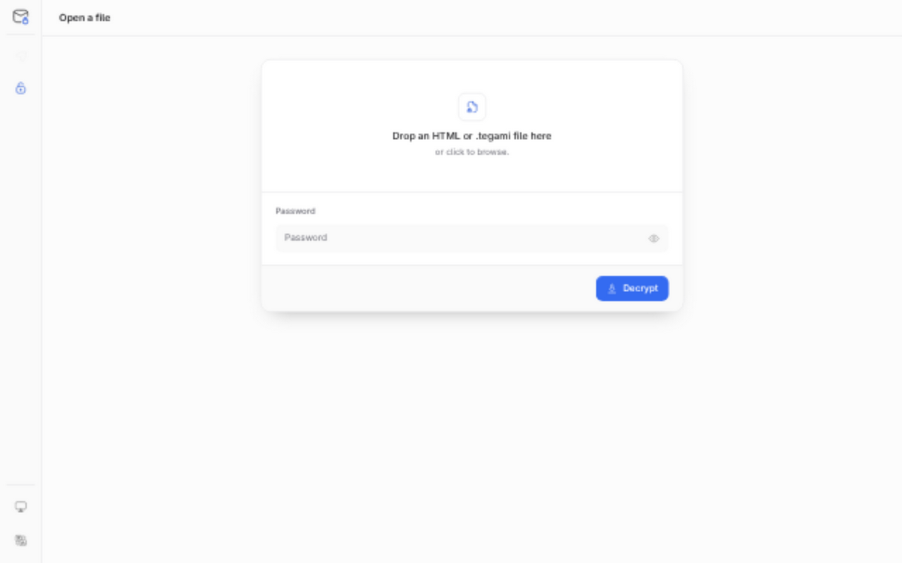

# Studio guide

The Studio is a single page, `tegami.html`, that encrypts and opens files in
your browser. It works offline and never connects to the network.

Get it from the [latest release](getting-started.md#download-a-release), or
create it with `tegami studio`.

## Send files

1. Open `tegami.html`. **Send**, the paper plane in the left rail, is
   selected.
2. Drop files or a folder onto the drop area, or click it to browse. **Add a
   folder** picks a whole folder. Remove a file with its **×** button, or
   start over with **Clear**.

   One file is sent as it is. Several files or a folder are sent as one ZIP,
   named `files.zip` or after the folder.
3. Choose a **Format**:
   - **HTML file** saves `<codename>.html`, which opens in any modern browser.
     Up to 50 MiB.
   - **Tegami file** asks where to save `<codename>.tegami`. Up to 3 GiB, and
     needs a Chromium-based browser on both ends.

   The Studio switches to Tegami file when the selection is over 50 MiB.
4. A strong **Password** is filled in for you. Copy it, select **Generate**
   for another, or type your own of at least 12 characters. The strength bar
   is only a rough guide, so the generated password is the safe choice.
5. Select **Encrypt**.
6. The result card shows the file to send and its codename, such as
   `quiet-harbor`. Send the file any way you like: email, chat, a file share,
   or a USB stick.
7. Share the password another way, for example by phone, and mention the
   codename so the recipient knows which file it opens. **Copy password** on
   the result card copies it.

Anyone with both the file and the password can open it. For a Tegami file,
the recipient also needs `tegami.html`. Point them to the release page, or
send it separately from the `.tegami` file.

Select **Encrypt more files** to start again.

## Open an HTML file

1. Open the `.html` file in a browser. It shows the codename, the size, and a
   password field.
2. Enter the password and select **Decrypt and download**.
3. The file downloads under its real name. If several files were sent, it is a
   ZIP.

If you don't trust the sender, open it in your own copy of the Studio
instead, so their page never runs: select **Open**, the padlock in the rail,
choose the `.html` file, enter the password, and select **Decrypt**. See the
[security model](security.md#untrusted-html-deliveries) for why.

<picture>
  <source media="(prefers-color-scheme: dark)" srcset="assets/tegami-open-dark.png">
  
</picture>

## Open a Tegami file

1. Open your copy of `tegami.html` in Chrome, Edge, Brave, or another
   Chromium-based browser, and select **Open**.
2. Drop the `.tegami` file onto the drop area, or click it to browse. The
   Studio shows its codename and size.
3. Enter the password, select **Decrypt**, and choose where to save the file.

The password is checked before you choose where to save. If the file turns out
to be damaged partway through, nothing is saved.

## Appearance and language

The Studio follows your system's light or dark setting. The theme button at
the bottom of the rail switches between **System**, **Light**, and **Dark**.

Pages are in English and Japanese and follow your browser's language. Change
it with the language button at the bottom of the rail, or under the password
form on a delivery. An HTML delivery carries both languages, so recipients
see their own. Codenames are the same in every language.

Both choices are remembered in this browser.

## Browser support

| Task | Chromium (Chrome, Edge, Brave) | Firefox | Safari |
| --- | --- | --- | --- |
| Create or open an HTML file | Yes | Yes | Yes |
| Create or open a Tegami file | Yes | No | No |

## Limits

- **Size**: up to 50 MiB for an HTML file and 3 GiB for a Tegami file. For
  several files, the limit applies to the ZIP.
- **Files**: up to 65,535 in one delivery. System files such as `.DS_Store`
  and `Thumbs.db` are left out.
- **Filename**: up to 180 bytes, without `/`, `\`, or line breaks. The CLI uses
  the same rule.
- **Password**: 12 to 4096 bytes, on one line.

## Troubleshooting

| Message | What to do |
| --- | --- |
| *The password is incorrect, or the file is damaged.* | Check the password, including capitals and spaces. If it is right, the file was changed or cut short on the way; ask for it again. Tegami can't tell these apart. |
| *HTML files are limited to 50 MiB. Choose Tegami file instead.* | Choose **Tegami file**, or send fewer files. |
| *Tegami files need Chrome, Edge, or another Chromium browser.* | Use a Chromium-based browser, or choose **HTML file**. |
| *Rename the file first: …* | Rename the file and add it again. |
| *The browser blocked the save dialog. Select the button again.* | Select the button again; the browser needs a fresh click. |
| *This is a ZIP file. Extract it, then choose the HTML delivery inside.* | Extract the ZIP and open the HTML file inside. |
